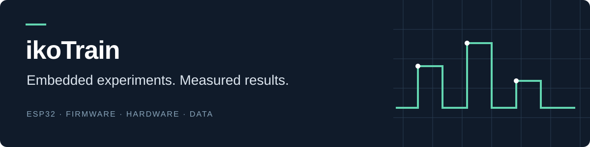



  

### Hi, I'm ikoTrain

Exploring embedded systems, electronics, and firmware. I enjoy turning ideas into working hardware and understanding what happens behind the measurements.

**Current project:** [ProduceSense](https://github.com/ikoTrain/ProduceSense) — an ESP32 experiment in recognizing produce through electrical measurements.

ESP32 · Arduino / C++ · Electronics · Experimental projects
